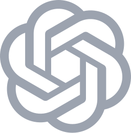
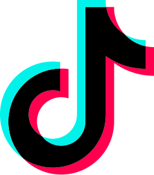
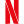
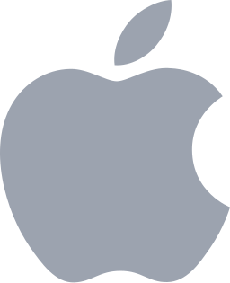

# 浏览器图标对照

按 2026-10-09 用户打开的 Open-Box 面板保存 **14 个服务分流组的原图**，另保留空白「前置自定义分流」的图标。下面保留页面的分组顺序和大小写，源标识均来自页面实际配置。页面记录的图标缩放值均为 `0`。

这里的 SVG 是浏览器原图。尚未证实 Shadowrocket 支持通过配置为策略组绑定这些远程 SVG，因此配置未加入未经证实的 `icon=` 等参数。原图保留在仓库中，用于对照和以后确认客户端支持后的接入。

## 目标分流（14 组）

| 顺序 | 页面名称 | 浏览器原图 | 源标识 |
| --- | --- | --- | --- |
| 1 | Test |  [speedtest.svg](../assets/icons/speedtest.svg) | `brand:speedtest` |
| 2 | AI |  [openai-light.svg](../assets/icons/openai-light.svg) | `brand:openai-light` |
| 3 | Youtube |  [youtube.svg](../assets/icons/youtube.svg) | `brand:youtube` |
| 4 | TikTok |  [tiktok.svg](../assets/icons/tiktok.svg) | `brand:tiktok` |
| 5 | Netflix |  [netflix-mono.svg](../assets/icons/netflix-mono.svg) | `brand:netflix-mono` |
| 6 | Google |  [google.svg](../assets/icons/google.svg) | `brand:google` |
| 7 | Github |  [github-mono.svg](../assets/icons/github-mono.svg) | `brand:github-mono` |
| 8 | Microsoft |  [microsoft.svg](../assets/icons/microsoft.svg) | `brand:microsoft` |
| 9 | Apple |  [apple-light.svg](../assets/icons/apple-light.svg) | `brand:apple-light` |
| 10 | Games |  [game-soft.svg](../assets/icons/game-soft.svg) | `misc:game-soft` |
| 11 | 区块链金融 |  [binance.svg](../assets/icons/binance.svg) | `brand:binance` |
| 12 | 国外 |  [earth-americas.svg](../assets/icons/earth-americas.svg) | `globe:earth-americas` |
| 13 | 国内 |  [shield.svg](../assets/icons/shield.svg) | `misc:shield` |
| 14 | 其他 |  [generic.svg](../assets/icons/generic.svg) | `globe:generic` |

## 前置自定义分流

页面另有「前置自定义分流」，原图是  [pin.svg](../assets/icons/pin.svg)，源标识 `misc:pin`。参考时该项为空规则，不因此新增策略组。

## 保存方式与来源

- 外链静态 SVG 按原字节复制，仅改成本地可读文件名；内嵌 SVG 保留图形路径、颜色及 `viewBox`，按需补充 SVG 命名空间并去除页面固定尺寸和样式类，不重绘图案。
- `speedtest.svg`、`github-mono.svg` 保留 `currentColor`，原面板颜色随主题变化。独立图片的默认颜色可能与面板深色主题不同；其余 SVG 保留原始颜色。
- 本批图标全部通过标准库 XML 解析，确认有 `viewBox`，且不含脚本、事件处理器、外部引用或 `foreignObject`。这只检查文件结构，不代表已经在 Shadowrocket 中加载测试。
- 来源是用户提供的 Open-Box 页面。公开项目为 [liandu2024/Open-Box](https://github.com/liandu2024/Open-Box)；本次未从该公开仓库确认这些具体图标的授权声明，第三方原图不按本仓库 MIT 许可证重新授权。
